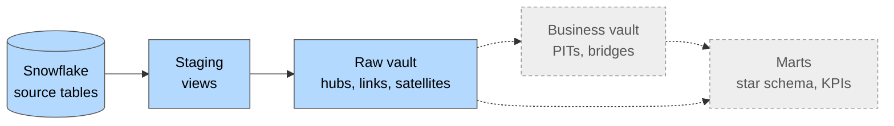

# dbt-data-vault

A data warehouse on **Snowflake**, built with **dbt** on Snowflake's fictional **Tasty Bytes**
food-truck data (~920 million source rows). Source data is cleaned in a staging layer,
integrated with full history in a **Data Vault 2.0** layer, and will be served to BI as a star
schema with SCD Type 2 dimensions. The project runs on the **dbt Fusion engine**.

## What this project demonstrates

**Data modeling**
- [**Layered architecture with clear responsibilities**](docs/dbt_design.md#layers-and-responsibilities):
  staging cleans and types source data, the Data Vault integrates it with full history, and the
  marts serve BI (roadmap).
- [**Modeling decided by data profiling**](docs/staging.md#data-profiling-findings): grain,
  nullability and value domains were checked against ~920M source rows before modeling, and the
  findings are written in the model docs.

**dbt engineering**
- [**Reusable macros instead of repeated SQL**](docs/dbt_design.md#macros-as-the-loading-framework):
  hub, link and satellite models are one short macro call each. The loading logic lives in
  documented project macros.
- [**Incremental, insert-only loading**](docs/dbt_design.md#incremental-insert-only-loading):
  append-only models where re-running a load adds nothing, with history simulated by setting the
  load timestamp through `--vars`.
- [**SQL checked before it runs**](docs/dbt_design.md#static-analysis-with-dbt-fusion): the dbt
  Fusion engine checks every model's SQL at compile time, so errors show up before anything runs
  on the warehouse.

**Testing and documentation**
- [**Tests scaled for the data volume**](docs/testing.md#tests-at-scale): ~350 data tests and 8 unit
  tests, including incremental scenarios. On the largest tables, tests check only the current
  batch, and full scans are tagged so they can be skipped.
- [**Every model and column documented**](docs/dbt_design.md#conventions): one YAML file per
  model, with grain, keys and data facts.

**Snowflake operations**
- [**Compute and access matched to the workload**](docs/dbt_design.md#environments-and-access):
  separate warehouses per environment and a larger warehouse set per model for the order tables.
  Dev and prod use separate roles, and credentials come from environment variables.

## Architecture



| Layer | Folder | Schema (dev) | Materialization | Status |
|---|---|---|---|---|
| Staging | `models/staging/` | `dev_stg` | view | Built |
| Data Vault | `models/datavault/` | `dev_vault` | incremental, insert-only | Raw vault built, business vault planned |
| Marts | `models/marts/` | `dev_marts` | table | Planned |

- **Staging** renames, casts and flattens the source data, and adds the hash keys the vault needs.
  No joins, no business logic. See [docs/staging.md](docs/staging.md).
- **Raw vault** stores the data as delivered, around business keys, and keeps every version.
  No business rules. See [docs/raw_vault.md](docs/raw_vault.md).
- **Business vault and marts** will apply the business rules and build the star schema for BI.

## Source data

The data comes from the public bucket `s3://sfquickstarts/tasty-bytes-builder-education/`,
loaded once into `tasty_bytes.source`. Each table has one staging view, `stg_raw__<table>`.

| Table | Grain (business key) | Rows | Description |
|---|---|---:|---|
| `customers` | `customer_id` | 222,540 | Loyalty-program members, with PII and profile attributes. |
| `franchises` | `franchise_id`, city | 335 | Franchisees operating trucks, one row per franchise and city. Franchise 1 is Tasty Bytes itself. |
| `locations` | `location_id` | 13,093 | Places where the trucks sell, with city, region and country. |
| `products` | `menu_item_id` | 100 | Menu items with category, cost, price and health metrics, for 15 truck brands. |
| `trucks` | `truck_id` | 450 | Food trucks, with their franchise, brand, primary city and vehicle data. |
| `orders_header` | `order_id` | ~248M | Orders placed at a truck, location and shift, optionally by a loyalty customer (2019-01 to 2022-11). |
| `orders_detail` | `order_detail_id` | ~674M | Order lines: product, quantity, unit price and line amount. |

## Data Vault at a glance

The raw vault has **9 hubs, 10 links, 12 satellites and 4 effectivity satellites**, all loaded
insert-only by project macros. Business entities (customer, truck, franchise, location, product,
brand, city, order, shift) are hubs; their relationships are links; descriptive attributes are
satellites, with PII kept in separate satellites. The model diagram, design decisions and full
table list are in [docs/raw_vault.md](docs/raw_vault.md).

## Project structure

```
db_init/                  Snowflake setup: database, roles, warehouses, source load
macros/datavault/         Loading macros (hub, link, sat, eff_sat) and hashing helpers
models/
  staging/                One view per source table, plus source definitions
  datavault/raw_vault/    hubs/, links/, sats/
  marts/                  (roadmap)
docs/                     Design documentation
dbt_project.yml           Layer configuration (schemas, materializations, static analysis)
profiles.yml              dev and prod targets, credentials from environment variables
```

## Getting started

**Prerequisites**: a Snowflake account with the `ACCOUNTADMIN` role (a trial account works) and
the [dbt Fusion engine](https://docs.getdbt.com/docs/fusion) 2.0.

1. **Set up Snowflake.** In a Snowflake worksheet, run
   [`db_init/tasty_bytes_admin.sql`](db_init/tasty_bytes_admin.sql) (set your Snowflake user
   in `SET dbt_user` at the top), then [`db_init/tasty_bytes_source.sql`](db_init/tasty_bytes_source.sql) to load the
   source tables.
2. **Set the credentials.** Copy `.env.example` to `.env` and fill in your account, user and
   password. dbt Fusion reads `.env` from the project root.
3. **Build.**

   ```bash
   dbt deps                                        # install dbt_utils
   dbt debug                                       # check the connection
   dbt build -s staging                            # staging views and their tests
   dbt build -s datavault --exclude tag:heavy_test # raw vault, skipping full-scan tests
   ```

The order tables hold ~920M rows, and their models use the larger `compute_big` warehouse. Use
`--exclude tag:large_table` to build everything else first.

## Testing

~350 data tests and 8 unit tests. Every model has key, nullability and reference tests, and the
loading macros are unit-tested on first-load and incremental scenarios. On the order tables,
tests check only the current batch, and full scans are tagged `heavy_test`. See
[docs/testing.md](docs/testing.md).

## Roadmap

1. **Business vault**: point-in-time tables, a bridge for orders, a same-as link for city
   spellings, and derived satellites for margins and member history.
2. **Marts**: a star schema with SCD Type 2 dimensions (customer, truck, product), facts at order
   line, shift and customer-month grain, and monthly KPI models.
3. **Simulated loads**: data sets loaded in date order to show history building up in the vault
   and the SCD2 dimensions.

## Documentation

| Document | Content |
|---|---|
| [docs/dbt_design.md](docs/dbt_design.md) | Layers, environments, conventions, macros, incremental strategy, Fusion static analysis, decision log. |
| [docs/staging.md](docs/staging.md) | Source data, data profiling findings, staging rules and models. |
| [docs/raw_vault.md](docs/raw_vault.md) | Data Vault standards, ghost records, model diagram, design decisions, table reference. |
| [docs/testing.md](docs/testing.md) | Testing approach by layer, tests at scale, unit tests. |

## License

This is a personal portfolio project. The source code is provided for viewing
and evaluation purposes only. All rights reserved. See [LICENSE](LICENSE) for details.
