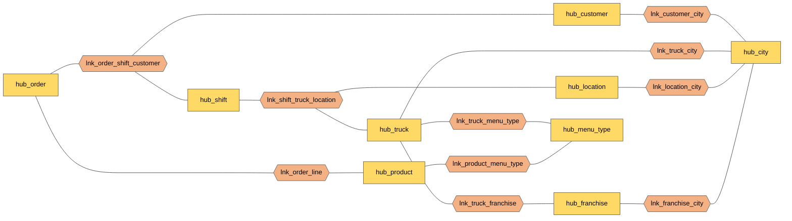
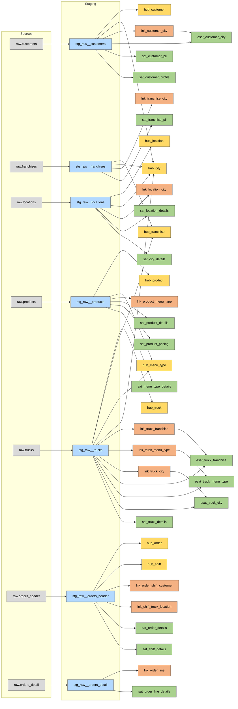

# Raw vault

The integration layer, modeled as a **Data Vault 2.0** raw vault in
[`models/datavault/raw_vault/`](../models/datavault/raw_vault/). It stores the source data as
delivered, around business keys, with full history. How the models are loaded (macros,
incremental strategy) is in [dbt_design.md](dbt_design.md#macros-as-the-loading-framework).

The raw vault holds **9 hubs, 10 links, 12 satellites and 4 effectivity satellites**.

## Standards

**Object types**

| Object | Prefix | Holds | Columns |
|---|---|---|---|
| Hub | `hub_` | One row per business key | `<entity>_hk`, business key, `load_dts`, `record_source` |
| Link | `lnk_` | One row per relationship between hubs | `<link>_hk`, hub hash keys, dependent child keys, `load_dts`, `record_source` |
| Satellite | `sat_` | Descriptive attributes, one row per version | parent hash key, `load_dts`, `<sat>_hashdiff`, payload, `record_source` |
| Effectivity satellite | `esat_` | Whether a link row is the current relationship | link hash key, `load_dts`, `is_active`, `record_source` |

**Naming**

- A link is named in business order, with the driving entity first: `lnk_order_shift_customer`
  (an order happens in a shift, for a customer). Its key drops the prefix:
  `order_shift_customer_hk`.
- A hashdiff is named after its satellite without the prefix: `customer_pii_hashdiff`.

**Hashing**

- Hub and link keys come from `hash_key()`, which sorts the key columns, so the name order of a
  link never changes its hash.
- Hashdiffs list the payload columns alphabetically, by hand.
- Values are hashed as staged, with no extra normalization.

**Modeling rules**

- **No business rules** in the raw vault. Cleansing beyond typing, derivations and KPIs belong to
  the business vault or the marts.
- **Satellites are split by sensitivity and rate of change.** PII (names, email, phone, birth date,
  postal code) has its own satellites, so access to it can be restricted and it can be left out of
  the marts. Product pricing is apart from product details because prices change more often.
- **No satellite without real attributes**: the franchise has no details satellite, because its
  only attributes were city and country, which are a hub of their own.

## Ghost records

Every hub and every satellite holds one **ghost record**: an all-zeros hash key (and hashdiff),
`load_dts` 1900-01-01, `record_source` `'SYSTEM'`, and NULL business key and payload.

- A missing business key points at the ghost row. About 95% of orders have no loyalty customer;
  their `customer_hk` is the all-zeros key, so the order link is complete and joins to
  `hub_customer` never lose rows.
- The satellite ghost row is what point-in-time tables will point to when a key has no version
  yet at a given date, so every join to a satellite can be an inner join.
- Display labels such as "Unknown" belong to the marts, not to the vault.

## Model

Hubs (yellow) and the links between them (orange). Satellites hang off each hub and link (see the
[reference tables](#reference-tables)).

Full lineage: sources → staging → raw vault

## Design decisions

**Geography is a hub.** City and country are not attributes of customers, trucks, locations or
franchises: they are the business key of `hub_city`, shared by all four through one link each. A
move shows up as a new link row, and the city is described once, in `sat_city_details`.
`locations` is the reference source for cities, so city attributes are loaded from it only. The
two spellings `England` and `United Kingdom` are both kept as delivered; resolving them is a
business rule for the business vault.

**The order model is centred on the shift.** The source has no shift table, but every order
carries a `shift_id` and the data confirms that a shift is one truck at one location in one time
window. So:

- `hub_shift` is the truck's availability, linked once to its truck and location in
  `lnk_shift_truck_location`;
- each order links to its shift and customer in **one three-way link**,
  `lnk_order_shift_customer`, instead of two separate 248M-row links;
- truck and location are reached through the shift, not repeated on every order.

**Order lines are a link with a dependent child key.** `lnk_order_line` links order and product,
with `line_number` as part of the key, because the same product can appear on two lines of one
order. Quantities and amounts are in `sat_order_line_details`.

**Effectivity satellites track the current relationship.** The sources are full snapshots without
delete markers, so a relationship ends only when its driving key arrives with a different
partner. The truck has three, because it can be transferred to another franchise, rebranded or
moved to another city independently. A driving key missing from a batch keeps its current
relationship.

**Some links have no effectivity satellite, on purpose.** A franchise operates in one or more
cities at once and the source doesn't say which are still active, so `lnk_franchise_city` lists
every city a franchise has operated in. Locations never move, so `lnk_location_city` doesn't need
one either.

## Load dates and history

- `load_dts` is the start time of the dbt run, the same for every model, unless the `load_dts` var
  overrides it (see [dbt_design.md](dbt_design.md#incremental-insert-only-loading)).
- The sources are a single snapshot, so the first load gives one version per key. History appears
  when later data sets are loaded.
- Data sets must be loaded **in date order**: a satellite compares each staged row with its latest
  version by `load_dts`, so an older load after a newer one would compare against the wrong
  version.
- End dates are never stored. They are derived downstream from the next version's `load_dts`.

## Known gaps

- `lnk_product_menu_type` has no effectivity satellite. Products don't change brand in the data; one
  will be added if they can.
- `lnk_location_city` has no effectivity satellite. Locations always belong to the same city.

## Reference tables

### Hubs

| Hub | Business key | Loaded from |
|---|---|---|
| `hub_customer` | `customer_id` | customers |
| `hub_franchise` | `franchise_id` | franchises, trucks |
| `hub_truck` | `truck_id` | trucks |
| `hub_location` | `location_id` | locations |
| `hub_product` | `product_id` | products |
| `hub_menu_type` | `menu_type_id` | products, trucks |
| `hub_city` | `city`, `country` | locations, trucks, franchises, customers |
| `hub_order` | `order_id` | orders_header |
| `hub_shift` | `shift_id` | orders_header |

### Links

| Link | Hubs | Loaded from |
|---|---|---|
| `lnk_truck_franchise` | truck ↔ franchise | trucks |
| `lnk_truck_menu_type` | truck ↔ menu type | trucks |
| `lnk_product_menu_type` | product ↔ menu type | products |
| `lnk_customer_city` | customer ↔ city | customers |
| `lnk_franchise_city` | franchise ↔ city (one or more cities per franchise) | franchises |
| `lnk_location_city` | location ↔ city | locations |
| `lnk_truck_city` | truck ↔ city | trucks |
| `lnk_shift_truck_location` | shift ↔ truck ↔ location | orders_header |
| `lnk_order_shift_customer` | order ↔ shift ↔ customer (ghost customer for anonymous orders) | orders_header |
| `lnk_order_line` | order ↔ product, with `line_number` as dependent child key | orders_detail |

### Satellites

| Satellite | Parent | Payload |
|---|---|---|
| `sat_customer_pii` | `hub_customer` | Name, email, phone, birth date, postal code |
| `sat_customer_profile` | `hub_customer` | Gender, language, marital status, children, sign-up date |
| `sat_franchise_pii` | `hub_franchise` | Franchisee name, email, phone |
| `sat_location_details` | `hub_location` | Placekey, name, region |
| `sat_city_details` | `hub_city` | ISO country code |
| `sat_product_details` | `hub_product` | Name, category, subcategory, health flags, ingredients |
| `sat_product_pricing` | `hub_product` | Cost of goods, sale price |
| `sat_menu_type_details` | `hub_menu_type` | Menu type (cuisine), truck brand name |
| `sat_truck_details` | `hub_truck` | Region, ownership and EV flags, make, model, year, opening date |
| `sat_order_details` | `hub_order` | Order date and timestamp, currency, amount, total |
| `sat_shift_details` | `hub_shift` | Shift date, start and end time |
| `sat_order_line_details` | `lnk_order_line` | Order detail id, quantity, unit price, line amount |
| `esat_customer_city` | `lnk_customer_city` | `is_active`: the customer's current city |
| `esat_truck_city` | `lnk_truck_city` | `is_active`: the truck's current primary city |
| `esat_truck_franchise` | `lnk_truck_franchise` | `is_active`: the franchise currently operating the truck |
| `esat_truck_menu_type` | `lnk_truck_menu_type` | `is_active`: the brand the truck currently sells |
